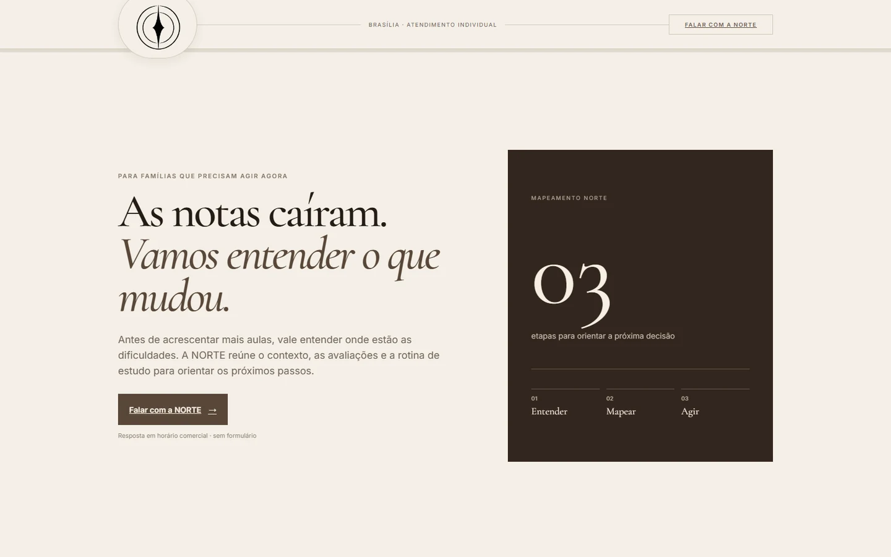

# NORTE — landing pages e experiências web

**Projeto de experiência web com foco em conversão**  
**Stack:** HTML · CSS · JavaScript · React · TypeScript · Vite  
**Código-fonte:** privado

## Objetivo

Construir variações de landing pages para apresentar os serviços da NORTE com clareza, confiança e um próximo passo visível. Em vez de uma página única repetida, o projeto explora direções visuais diferentes, com hierarquia, copy, tipografia, imagens e chamadas para contato.

As capturas foram feitas em ambiente local a partir de duas variantes estáticas. Elas documentam o trabalho visual, não comprovam publicação em produção nem resultados comerciais.

## Direção editorial

Uma composição tipográfica minimalista, paleta neutra e mensagem principal direta.

### Diagnóstico do problema

A seção explicita que uma queda nas notas pode ter causas distintas e apresenta o mapeamento como ponto de partida, antes de indicar mais acompanhamento.

### Método em três etapas

Contexto, mapeamento e direção organizam o fluxo de serviço numa sequência que pode ser compreendida rapidamente.

### Próximo passo e contato

A chamada para conversar reduz as etapas entre compreender a oferta e iniciar o contato.

### Dúvidas frequentes

As respostas a objeções comuns ajudam a esclarecer expectativas antes da conversa.

## Direção imersiva

Uma abordagem mais visual, com um hero de maior presença imagética e seções de comparação que ajudam a comunicar o método.

### Mudança de perspectiva

A seção contrasta uma resposta imediata com a proposta de compreender o caso antes de recomendar um caminho.

### Comparativo de abordagem

A tabela contrasta ações reativas com uma abordagem baseada em mapeamento e definição de próximos passos.

### Perguntas frequentes

A seção antecipa dúvidas do visitante e reforça a clareza dos combinados.

## Trabalho em destaque

- Estruturação de variantes visuais com objetivos comerciais comuns.
- Ajustes de hierarquia, copy, CTA e redução de atrito na primeira conversa.
- Implementação em páginas estáticas e aplicações Vite/React, conforme a variante.
- Verificação de build e sintaxe antes da revisão visual completa.

## Evidências e estado atual

- **Oito builds Vite passaram** na revisão registrada.
- **Duas variantes estáticas passaram** na checagem de sintaxe JavaScript.
- As imagens nesta página vêm das variantes estáticas persona-1, usadas para demonstrar a composição visual.
- **Ainda pendente:** revisão visual por viewport, responsividade sistemática, testes E2E e conferência final de links, assets e direitos de uso das imagens.
- **Métricas:** não há dados de conversão publicados; este estudo de caso não atribui aumento de leads ou desempenho comercial às páginas.

## Referências técnicas

- [Vite — guia](https://vite.dev/guide/)
- [React — documentação](https://react.dev/)
- [TypeScript — documentação](https://www.typescriptlang.org/docs/)
- [MDN — HTML](https://developer.mozilla.org/docs/Web/HTML)
- [MDN — CSS](https://developer.mozilla.org/docs/Web/CSS)
- [MDN — JavaScript](https://developer.mozilla.org/docs/Web/JavaScript)
