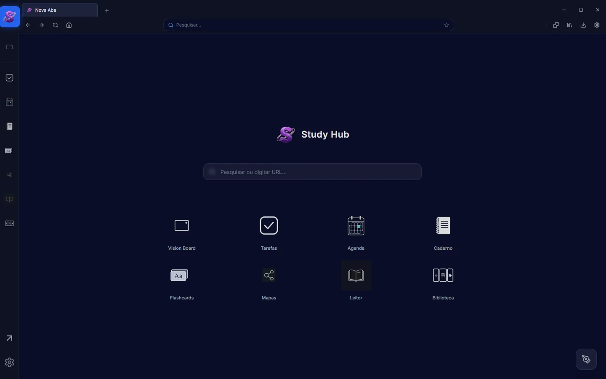
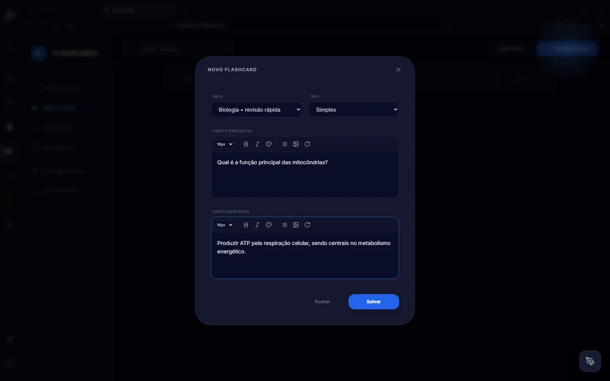

# Study Hub Browser

**Aplicação desktop de estudo e produtividade**  
**Stack:** Electron · React · TypeScript · Vite  
**Código-fonte:** privado

## Problema e objetivo

O estudo costuma acontecer entre várias ferramentas: navegador, editor de notas, tarefas, agenda, flashcards e leitor de documentos. O Study Hub Browser busca reunir esses fluxos em um único ambiente desktop, sem transformar a aplicação em um painel pesado ou desconectado do trabalho cotidiano.

## Solução

O produto combina uma interface de navegação desktop com módulos dedicados a:

- navegação e abas;
- anotações e caderno;
- tarefas e cronograma;
- flashcards e organização por decks;
- mapas mentais e Vision Board;
- leitura de documentos e biblioteca.

O editor de flashcards oferece campos distintos para pergunta e resposta e apresenta opções de formatos, como cartões simples, inversos e cloze. A tela reproduzida nesta página utiliza apenas conteúdo demonstrativo fictício.

*Captura da tela inicial do produto, feita em ambiente local.*

*Captura do editor; o texto sobre mitocôndrias foi criado apenas para a demonstração.*

## Decisões de produto e engenharia

- **Experiência coesa:** a navegação lateral organiza módulos distintos dentro do mesmo shell desktop.
- **Separação de responsabilidades:** Electron cuida do shell nativo; React e TypeScript estruturam a interface.
- **Fluxos reconhecíveis:** cada módulo tem uma função clara, em vez de concentrar tudo em um único formulário.
- **Demonstração segura:** as capturas publicadas não contêm dados pessoais ou dados reais de estudo.

## Validação e limites atuais

O build de produção da interface passou na revisão de staging. O autor confirma que o produto funciona no uso real. Isso não deve ser interpretado como certificação integral de todas as rotas ou da distribuição final: o empacotamento a partir de instalação limpa, o refinamento de bundle/Fabric e a revisão final de segurança do Electron permanecem como etapas de distribuição.

## Próximos critérios de qualidade

1. Validar uma instalação limpa do pacote desktop em ambiente controlado.
2. Executar uma regressão explícita dos principais fluxos de navegação, estudo e persistência.
3. Revisar opções de linha de comando e configurações de segurança do Electron antes de distribuir o aplicativo.
4. Medir o efeito de melhorias de performance com dados reproduzíveis, evitando conclusões apenas pela impressão visual.

## Referências oficiais

- [Electron — documentação](https://www.electronjs.org/docs/latest/)
- [Electron — boas práticas de segurança](https://www.electronjs.org/docs/latest/tutorial/security)
- [React — documentação](https://react.dev/)
- [TypeScript — documentação](https://www.typescriptlang.org/docs/)
- [Vite — guia](https://vite.dev/guide/)
